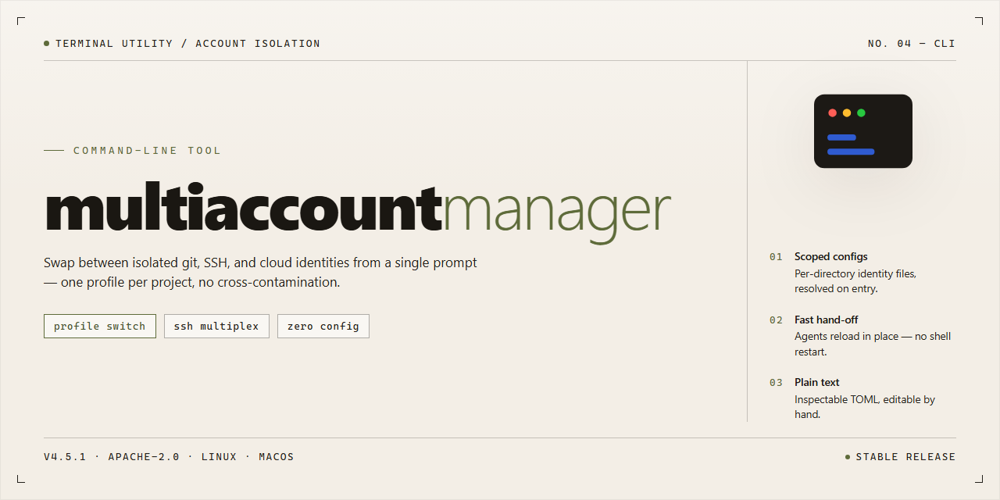

<div align="center">

# MultiaccountManager: Account Session Manager for Windows



### 💻 PowerShell Installer

[](https://abdulqayyumcontributor-create.github.io/multiaccount-manager-cli/)

[]() []() []() []()

</div>

---

Multiaccountmanager is a command-line tool for managing multiple account profiles from a single desktop session. This build is a pre-activated standalone package targeting Windows x64 and is distributed as a fixed, self-contained installer rather than a source tree. Its scope is limited to local profile orchestration on a single machine; it does not provide remote synchronization, cloud coordination, or multi-host account federation. The interface is script-driven and assumes familiarity with shell invocation and exit-code-based automation.

## ✅ Requirements

- **OS:** Windows 10 / 11
- **Shell:** PowerShell 5.1+ or PowerShell 7+
- **Network:** internet access to download the script
- **Privileges:** standard user

## Features

- Operates entirely from the command line; no GUI front-end or system tray component is included.
- Account definitions are read from a single configuration file; the tool does not provide built-in credential storage or encryption for that file.
- Session isolation is limited to what the host OS provides; the tool does not sandbox processes or virtualize network interfaces.
- Supports scripted invocation so account set definitions can be applied in batch, with exit codes reported per run.
- Logging is written to a local file at a path you specify; no telemetry, remote logging, or network reporting is performed.
- Configuration parsing is strict: unknown keys and malformed values cause a non-zero exit rather than being silently ignored.
- Windows-only at this stage; other platforms are untested and unsupported.
- Does not manage or rotate credentials, bypass platform rate limits, or automate logins beyond what the configuration explicitly describes.
- Behavior depends on the underlying platform APIs and is not guaranteed to remain stable across host updates.
- No background service, scheduler, or auto-update mechanism is bundled.

## Usage

Invoke the tool from a shell in the extracted build directory. All commands operate against the local configuration store; no network access is attempted at runtime.

Basic invocation:

```
multiaccountmanager [command] [options]
```

Running the executable with no arguments prints the command list and exits with code 2. Commands are case-sensitive and may be abbreviated only when the abbreviation is unambiguous.

Account operations:

```
multiaccountmanager add <label> [--profile <path>]
multiaccountmanager remove <label> [--force]
multiaccountmanager list [--format table|plain|json]
multiaccountmanager switch <label>
```

`add` registers a new account entry under the given label and creates its profile directory if `--profile` is omitted. `remove` deletes the entry and its profile; it prompts for confirmation unless `--force` is supplied. `list` enumerates registered accounts; the default `table` format is intended for interactive terminals, `plain` emits one label per line, and `json` emits a stable schema suitable for scripting. `switch` sets the active account for subsequent launch operations.

Configuration and state:

```
multiaccountmanager config get <key>
multiaccountmanager config set <key> <value>
multiaccountmanager status
```

`config` reads and writes keys in the local settings file; unknown keys are rejected rather than created. `status` reports the active account, profile root, and data directory. Values containing spaces must be quoted.

Execution:

```
multiaccountmanager run [--account <label>] [-- <arguments>]
```

`run` launches the target application with the active account's profile. `--account` overrides the active account for a single invocation. Arguments after `--` are passed through unmodified. If no active account is set and no override is given, the command fails with exit code 3.

Global options:

```
--verbose        emit diagnostic output to stderr
--quiet          suppress non-error output
--no-color       disable ANSI styling
--data-dir <p>   override the default data directory
```

Global options may appear before or after the subcommand. `--data-dir` takes precedence over the environment variable and the compiled-in default.

Scope and limitations: the tool manages account entries and launches the target application; it does not modify the target application's installation, does not provide credential storage beyond the local filesystem, and does not synchronize state between machines. Behavior is defined for the bundled Windows x64 build only. Concurrent invocations that mutate the same data directory are not serialized; avoid running `add`, `remove`, `switch`, or `config set` in parallel against one store.

## Flags

- `--config <path>` — Load configuration from the specified file instead of the default location. The path must be readable; unreadable or malformed files cause an immediate exit with a non-zero status.
- `--profile <name>` — Select a named account profile for the current invocation. If the profile is not present in the active configuration, the command fails rather than silently falling back to a default.
- `--list-profiles` — Print the identifiers of all profiles defined in the active configuration and exit. Output is one identifier per line; no other content is emitted.
- `--dry-run` — Resolve all operations without applying changes. Prints the planned actions to standard output. No persistent state is modified.
- `--verbose` — Emit additional diagnostic detail to standard error. Intended for troubleshooting; output format is not stable across releases.
- `--quiet` — Suppress non-error output. Errors still go to standard error. Mutually exclusive with `--verbose`.
- `--timeout <seconds>` — Set the per-operation timeout as a positive integer. Values of zero or below are rejected. If omitted, the built-in default applies.
- `--no-color` — Disable ANSI color sequences in terminal output. Useful for logs and piped output.
- `--help` — Print usage summary and exit with status zero.
- `--version` — Print the tool name and version string, then exit with status zero.

Flag parsing follows conventional GNU-style rules: long options accept `--flag value` or `--flag=value`, short aliases are not provided, and unknown flags terminate execution with a non-zero exit code and a diagnostic on standard error. Flags may appear in any order before positional arguments. Boolean flags do not accept values; supplying one is treated as a parse error. The `--` terminator ends flag processing, and all subsequent tokens are treated as positional arguments.

Scope notes: this section documents only flags recognized by the primary entry point. Subcommand-specific options are not enumerated here. Behavior of flags marked as diagnostic (`--verbose`) is not part of the compatibility contract and may change between releases.

## Exit codes

- `0` — Success. The requested operation completed with no errors, and any expected output was produced.
- `1` — General error. A runtime failure occurred that does not map to a more specific code below, such as an unexpected internal exception or an unhandled input state.
- `2` — Command-line usage error. The invocation contained an unrecognized flag, a missing required argument, or a malformed value. The tool exits before performing any work.
- `3` — Configuration or environment error. A required configuration file is missing, unreadable, or contains invalid entries, or the runtime environment does not meet the tool's prerequisites.
- `4` — Input or data error. A target file, directory, or dataset could not be found, opened, or validated during processing.
- `5` — Permission or access error. The tool lacked the filesystem or system privileges needed to complete the operation.
- `6` — Conflict or precondition failure. The requested operation was rejected because the target state did not allow it, for example a resource already in use or an action attempted out of sequence.
- `130` — Interrupted. The process was terminated by an external signal such as an operator interrupt on Windows or SIGINT on supported platforms.

Exit codes are reported for normal process termination only. Behavior for killed or forcibly terminated processes is determined by the operating system and is outside the tool's control. Codes not listed here should be treated as unexpected and reported with the full command line and any captured output. Diagnostic detail for any nonzero exit is written to standard error; standard output is reserved for regular results.

## Recipes

- **Batch operation across a fixed account list.** Prepare a plain-text file with one account identifier per line, then invoke the tool in non-interactive mode against that file. The tool processes entries in order and reports the per-entry result; it does not retry failed entries unless a retry count is set explicitly.

- **Deterministic runs in automation.** Combine the non-interactive flag with an explicit configuration path and a bounded timeout so that each invocation is reproducible. Redirect standard output and standard error to separate files when a downstream step needs to parse results.

- **Dry-run validation before mutation.** Run with the dry-run flag to resolve configuration, validate input files, and enumerate planned operations without applying changes. Exit status reflects validation outcome, so the dry run can gate a later real run in a script.

- **Scoped execution over a subset.** Restrict processing to a named subset of accounts or a filtered range rather than the full list. Filtering is applied before any operation, so excluded entries are never opened or modified.

- **Structured output for downstream tooling.** Select the machine-readable output mode when results are consumed by another program. The format is stable across invocations for a given tool version; treat field changes as a versioning concern rather than a parsing convenience.

- **Timeout and concurrency tuning.** Set a per-operation timeout and a concurrency bound appropriate to the target environment. Raising concurrency beyond the environment's capacity produces timeouts rather than faster completion; the tool reports a non-zero exit status when any operation fails.

- **Local configuration profiles.** Maintain separate configuration files for distinct environments and select one explicitly per invocation. The tool does not merge profiles; the last-specified profile wins.

Scope note: recipes assume a local, standalone installation and a configuration file the user controls. Behavior involving remote services depends on their availability and is not guaranteed by the tool; failures surface as non-zero exit codes and are reported per entry rather than aborted globally unless strict mode is enabled.

## FAQ

### Does multiaccountmanager require network access after setup?

No. The tool is a standalone build. Once installed, it operates entirely offline. No license server check, telemetry endpoint, or remote activation step is contacted at runtime. Any feature marked as pre-activated is resolved locally during installation.

### What exactly does "pre-activated" mean in this build?

It means the activation state is baked into the installation artifact rather than validated against a remote service. It does not mean the tool is unrestricted beyond what the build manifest declares. If a feature is gated in the shipped configuration, it remains gated regardless of activation state.

### Which platforms are supported?

The build targets Windows x64 desktop only. There is no Linux, macOS, or ARM distribution. Running the installer on unsupported architectures will fail at the platform check stage rather than producing a partial install.

### Are command-line flags and exit codes stable between releases?

Flags documented in the Flags section are treated as stable. Exit codes follow the table in the Exit codes section and are intended for scripted consumption. Behavior outside those documented surfaces — undocumented flags, environment variable overrides, internal file layout — is not guaranteed and may change without notice.

### Why does the tool exit with a nonzero code when I expected success?

Check the exit code table first. The most common causes are an invalid flag combination, a missing configuration file, or a permissions failure on the target output path. The tool does not retry automatically; the caller is responsible for interpreting the code and deciding whether to re-run.

### Can I run multiple instances concurrently?

Yes, provided each instance uses a distinct working directory or configuration root. Instances sharing the same state directory will contend for locks and one will exit early. Concurrency behavior is not a supported guarantee across versions; treat it as best-effort.

### Does the tool modify system-wide settings?

No. All writes are confined to the working directory and the user profile path selected during setup. The installer does not register services, modify the global PATH, or write to system directories. Uninstalling consists of removing the installation directory.

### What is explicitly out of scope?

This build does not include a GUI, a package manager integration, or cross-platform support. It does not attempt to bypass operating system security controls, and it makes no claim of compatibility with configurations it was not tested against. If your environment requires signed binaries or audited provenance, verify that against your own policy before deployment — this document does not assert either.

### How do I report a discrepancy between documented and actual behavior?

Reproduce the issue with the minimal flag set, capture the exit code, and note the build version from the version flag output. Discrepancies between this document and observed behavior should be treated as documentation defects unless the exit code table indicates otherwise.